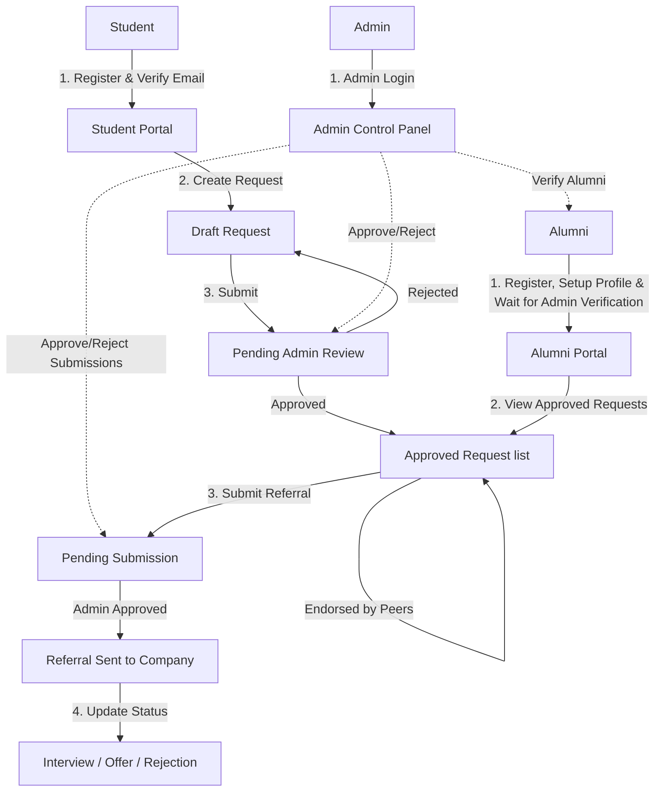
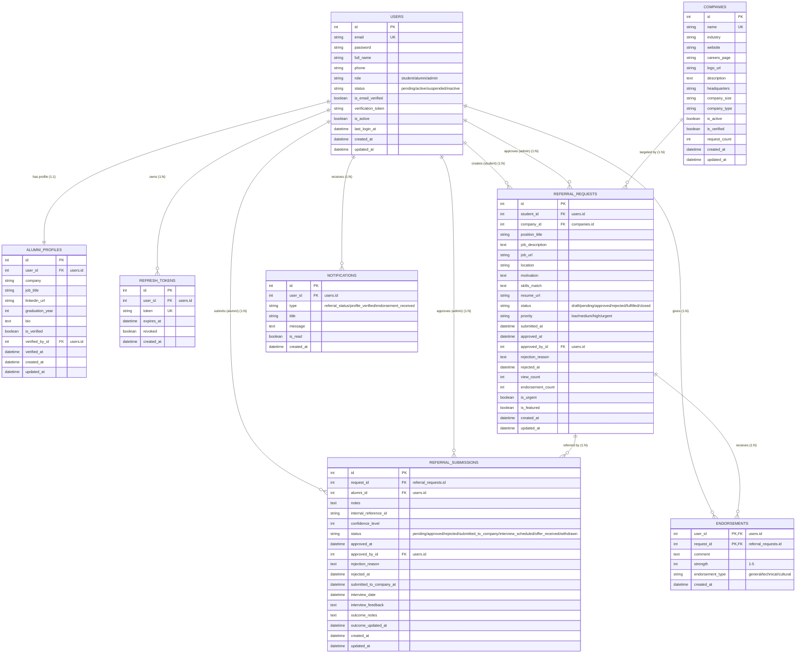
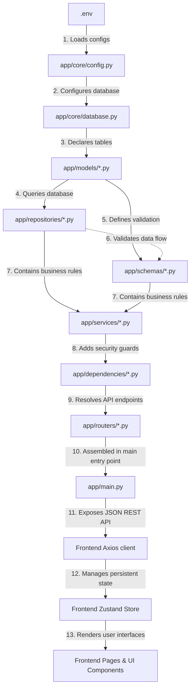

# AlumniConnect: Complete Start-to-End Technical Guide & System Architecture
Welcome to the developer guide for **AlumniConnect**. This guide is designed to explain the entire project from end-to-end. It details how the system is structured, how data flows, the roles of different users, the database design, and a day-by-day roadmap showing how to build it from scratch.

---

## 1. What is AlumniConnect? (Explained to a 5-Year-Old 🧸)

Imagine a school where students want to get jobs at cool companies. But it is very hard to get a job unless a nice older brother or sister (an **Alumni**) who already works at that company introduces you to the boss.

Our project, **AlumniConnect**, is like a **Digital Post Office**:
1. 📬 **The Student** writes a nice letter (a *Referral Request*) explaining why they are good at coding and why they want to work at a company (like Google).
2. 🕵️ **The Admin** (the postmaster) checks the letter to make sure it is polite and has all the information. If it is good, they stamp it as **Approved**.
3. 💼 **The Alumni** (the older brother/sister) logs in, sees the approved letters, and says, *"Hey, I work at Google! I can take this student's resume and hand it to my manager!"*
4. 🚀 **The System** tracks the whole journey, sending updates when the student gets an interview or a job offer!

---

## 2. User Roles & Permission Flows 👥

AlumniConnect has three distinct users. Here is what they see, what they enter, and what they get:



### Flow Matrix

| User Role | What they Enter (Input) | What they See (Interface) | What they Get (Output) |
| :--- | :--- | :--- | :--- |
| **Student** | • Login / Registration details<br>• Job details (Title, Company, URL, Description)<br>• Personal pitch (Motivation, Skills Match, Resume Link) | • Personal dashboard with stats<br>• List of own referral requests<br>• Company search directory<br>• Job request status timeline | • Referral requests submitted for approval<br>• System notifications when request is approved/rejected/referred |
| **Alumni** | • Professional details (Company, Job Title, LinkedIn, Graduation Year)<br>• Referral details (Internal Ref ID, confidence level, status updates) | • Alumni dashboard<br>• Directory of approved student requests<br>• Outcome updates (Interview Date, Feedback) | • Submitted referral recommendations for students<br>• Status updates on referral progress |
| **Admin** | • Review decisions (Approve/Reject buttons)<br>• Rejection comments / reasons | • Admin control panel<br>• List of unverified alumni accounts<br>• Pending student requests & pending submissions | • Verified alumni profiles<br>• Approved student requests & finalized company referrals |

---

## 3. Database Relational Schema (8 Tables) 🗄️

The database is built on **PostgreSQL** with 8 tables. Foreign key relationships link these tables together.



---

## 4. Architecture and File Import Order ⚙️

When building a full-stack project, you must build **bottom-up**. You cannot build routers without services, you cannot build services without repositories, and you cannot build repositories without database models.

Here is the exact order in which code was written and how files import each other:



---

## 5. The 13-Day Implementation Roadmap 📅

Here is the 13-day breakdown of how this project would be built.

### Day 1: Project Setup & Environment Configurations
We create the project workspace, set up Python's environment, write dependencies list, and establish configurations.
*   **Files written:**
    1.  `Alumni_Project_Final/requirements.txt`
    2.  `Alumni_Project_Final/.env`
    3.  `Alumni_Project_Final/app/core/config.py`
*   **What happens here:** Pydantic loads configuration variables from `.env` and checks types (e.g. checks that `DATABASE_PORT` is an integer). It puts them in a cached `settings` object so the app doesn't reload the file multiple times.

### Day 2: Database Connection & Base Exceptions
We configure database engine settings and setup custom HTTP errors.
*   **Files written:**
    1.  `Alumni_Project_Final/app/core/database.py`
    2.  `Alumni_Project_Final/app/core/exceptions.py`
*   **What happens here:** We build the connection engine with PostgreSQL, create a factory (`SessionLocal`) to generate individual database transactions, and define custom application-level exceptions (like `NotFoundException`, `UnauthorizedException`) so our API returns structured errors instead of raw server crashes.

### Day 3: Security Helpers, Hashing & Middlewares
We build tools to secure user accounts.
*   **Files written:**
    1.  `Alumni_Project_Final/app/core/security.py`
    2.  `Alumni_Project_Final/app/core/rate_limit.py`
    3.  `Alumni_Project_Final/app/middleware/security_headers.py`
    4.  `Alumni_Project_Final/app/middleware/error_handler.py`
*   **What happens here:** We set up password hashing using `bcrypt` (so passwords are never stored in plain text). We also add a rate-limiter to prevent hackers from spamming our login route, a security header middleware to protect against cross-site scripting (XSS), and a global error handling catcher to translate Python errors into clean JSON responses.

### Day 4: User Accounts & Verification Database Models
We write database tables for users, alumni profile details, and login tokens.
*   **Files written:**
    1.  `Alumni_Project_Final/app/models/user.py`
    2.  `Alumni_Project_Final/app/models/refresh_token.py`
    3.  `Alumni_Project_Final/app/models/alumni_profile.py`
*   **What happens here:** We translate python classes into SQL database tables using SQLAlchemy. We define user fields, statuses, roles (Admin/Student/Alumni), and the one-to-one link to `AlumniProfile` containing career information. We also define the `RefreshToken` table used for keeping users logged in securely.

### Day 5: Core Operations Database Models
We build the remaining database tables that handle companies, referrals, and endorsements.
*   **Files written:**
    1.  `Alumni_Project_Final/app/models/company.py`
    2.  `Alumni_Project_Final/app/models/referral_request.py`
    3.  `Alumni_Project_Final/app/models/referral_submission.py`
    4.  `Alumni_Project_Final/app/models/endorsement.py`
    5.  `Alumni_Project_Final/app/models/notification.py`
*   **What happens here:** We define the tables for target companies, referral requests (Student pitch/motivation), referral submissions (Alumni recommendations), endorsements (supporting requests), and notification records.

### Day 6: Pydantic Validation Schemas
We establish incoming data validation.
*   **Files written:**
    1.  `Alumni_Project_Final/app/schemas/user.py`
    2.  `Alumni_Project_Final/app/schemas/token.py`
    3.  `Alumni_Project_Final/app/schemas/company.py`
    4.  `Alumni_Project_Final/app/schemas/referral_request.py`
    5.  `Alumni_Project_Final/app/schemas/referral_submission.py`
    6.  `Alumni_Project_Final/app/schemas/response.py`
*   **What happens here:** Pydantic schemas validate that user input fits strict parameters (e.g. checking that passwords contain at least one uppercase letter, one lowercase letter, and a number) before data touches the database.

### Day 7: Database Repositories (Data Access Layer)
We create the functions that perform Database CRUD operations.
*   **Files written:**
    1.  `Alumni_Project_Final/app/repositories/base.py`
    2.  `Alumni_Project_Final/app/repositories/user.py`
    3.  `Alumni_Project_Final/app/repositories/company.py`
    4.  `Alumni_Project_Final/app/repositories/referral_request.py`
    5.  `Alumni_Project_Final/app/repositories/refresh_token.py`
*   **What happens here:** We separate SQL queries from business logic. The `BaseRepository` contains generic functions (`get_by_id`, `create`, `update`, `delete`), while child repositories contain custom SQL queries (like `get_by_email` or `get_approved`).

### Day 8: Business Logic Services & Role Security Guards
We build services to execute user tasks and guards to enforce route access.
*   **Files written:**
    1.  `Alumni_Project_Final/app/services/auth.py`
    2.  `Alumni_Project_Final/app/services/referral_request.py`
    3.  `Alumni_Project_Final/app/dependencies/auth.py`
    4.  `Alumni_Project_Final/app/dependencies/roles.py`
*   **What happens here:** We write core workflows (registering a user, generating access tokens, validating JWTs, checking user roles). Endpoints will depend on these scripts to confirm if a user is authorized.

### Day 9: API Routers & App Assembly
We bind the business services to URL routes.
*   **Files written:**
    1.  `Alumni_Project_Final/app/routers/auth.py`
    2.  `Alumni_Project_Final/app/routers/referral_requests.py`
    3.  `Alumni_Project_Final/app/routers/admin.py`
    4.  `Alumni_Project_Final/app/main.py`
*   **What happens here:** We setup routers mapping incoming HTTP requests (like `POST /auth/login`) to the appropriate Service functions. We integrate them in `main.py` and mount CORS middleware to allow the React frontend to communicate with the API.

### Day 10: Alembic Setup, Database Migrations & Seeding
We create the database schema structures and insert dummy test data.
*   **Files written:**
    1.  `Alumni_Project_Final/alembic/env.py`
    2.  `Alumni_Project_Final/alembic/versions/001_initial_schema.py`
    3.  `Alumni_Project_Final/scripts/seed_data.py`
*   **What happens here:** Alembic auto-generates SQL scripts to configure the database tables. We run a python script to populate the database with default accounts (admin, student, alumni) and mock companies for development testing.

### Day 11: Frontend Initial Setup, Core Client & Auth Store
We initialize the React application, establish the API client, and set up state storage.
*   **Files written:**
    1.  `Alumni_Frontend/package.json`
    2.  `Alumni_Frontend/src/main.tsx`
    3.  `Alumni_Frontend/src/lib/api-client.ts`
    4.  `Alumni_Frontend/src/store/auth.ts`
    5.  `Alumni_Frontend/src/types/index.ts`
*   **What happens here:** We establish our Axios client with request/response interceptors (so that if the backend returns a `401 Unauthorized` token expiry, Axios automatically sends a request to `/auth/refresh` to get a new token without logging the user out). We set up Zustand to save login state in local storage.

### Day 12: Frontend Layouts, Routing Guards & Services
We build shell layouts and API services for components.
*   **Files written:**
    1.  `Alumni_Frontend/src/App.tsx`
    2.  `Alumni_Frontend/src/layouts/MainLayout.tsx`
    3.  `Alumni_Frontend/src/layouts/AuthLayout.tsx`
    4.  `Alumni_Frontend/src/services/auth.service.ts`
    5.  `Alumni_Frontend/src/services/referral-request.service.ts`
*   **What happens here:** We write React Router paths, wrap protected paths in a role-guard element (`ProtectedRoute`), and create service utilities containing Axios calls for login, registration, and request submissions.

### Day 13: Frontend Dashboards & User Pages
We build the visual user interface pages.
*   **Files written:**
    1.  `Alumni_Frontend/src/pages/Dashboard.tsx`
    2.  `Alumni_Frontend/src/pages/ReferralRequests.tsx`
    3.  `Alumni_Frontend/src/pages/admin/AdminPanel.tsx`
    4.  `Alumni_Frontend/src/pages/auth/Login.tsx`
*   **What happens here:** We build the visual layouts: forms using `react-hook-form` + `zod` validation, statistics panels showing referral numbers, and role-based action sections.

---

## 6. Line-by-Line Code Explanations 💻

Here is the line-by-line explanation of the most important files in the project.

### BACKEND: `Alumni_Project_Final/app/core/database.py`

This script establishes the connection to the PostgreSQL database, configurations, and handles the session lifecycles.

```python
import urllib.parse
from sqlalchemy import create_engine
from sqlalchemy.ext.declarative import declarative_base
from sqlalchemy.orm import sessionmaker
from app.core.config import settings
```
*   **Line 1:** Imports Python's URL parser to safe-encode database characters.
*   **Line 2:** Imports `create_engine` which acts as the core database connector.
*   **Line 3:** Imports `declarative_base` which is the base class SQL models inherit from.
*   **Line 4:** Imports `sessionmaker` to generate individual database transactional sessions.
*   **Line 5:** Imports the application configuration settings.

```python
password = urllib.parse.quote_plus(settings.DATABASE_PASSWORD)
```
*   **Line 7:** Converts password characters (like `@` or `#`) into safe URL codes so they don't break the database connection URL parsing.

```python
SQLALCHEMY_DATABASE_URL = (
    f"postgresql://{settings.DATABASE_USERNAME}:{password}@"
    f"{settings.DATABASE_HOSTNAME}:{settings.DATABASE_PORT}/"
    f"{settings.DATABASE_NAME}"
)
```
*   **Line 9-13:** Assembles the PostgreSQL connection URL using username, URL-encoded password, hostname, port, and database name.

```python
engine = create_engine(
    SQLALCHEMY_DATABASE_URL,
    pool_size=settings.DATABASE_POOL_SIZE,
    max_overflow=settings.DATABASE_MAX_OVERFLOW,
    pool_timeout=30,
    pool_recycle=1800,
    echo=settings.DEBUG,
)
```
*   **Line 15-22:** Creates the database connector Engine.
    *   `pool_size=10`: Keeps 10 database connections open and ready to use.
    *   `max_overflow=20`: Allows up to 20 extra temporary connections if there's high traffic.
    *   `pool_recycle=1800`: Replaces database connections every 30 minutes to keep them fresh.
    *   `echo`: Prints database SQL logs to the console in Debug mode.

```python
SessionLocal = sessionmaker(
    autocommit=False,
    autoflush=False,
    bind=engine,
)
```
*   **Line 24-28:** Builds a factory object (`SessionLocal`) that creates single transaction sessions. Autocommit/autoflush are disabled so we explicitly control when records are saved.

```python
Base = declarative_base()
```
*   **Line 30:** Creates the base class `Base`. Every database table class we write will inherit from this base class, registering itself with SQLAlchemy.

```python
def get_db():
    db = SessionLocal()
    try:
        yield db
    finally:
        db.close()
```
*   **Line 32-38:** Yields a database transaction session.
    *   `db = SessionLocal()`: Opens a connection.
    *   `yield db`: hands it over to the router executing a query.
    *   `finally: db.close()`: Ensures the connection is closed when the request finishes, returning it to the pool.

---

### BACKEND: `Alumni_Project_Final/app/dependencies/auth.py`

This script secures endpoints. It generates JWT access tokens and checks incoming headers.

```python
from datetime import datetime, timedelta, timezone
from typing import Any, Dict
import secrets
from fastapi import Depends, HTTPException, status
from fastapi.security import OAuth2PasswordBearer
from jose import JWTError, jwt
from sqlalchemy.orm import Session
from app.core.config import settings
from app.core.database import get_db
from app.models.user import User
from app.schemas.token import TokenData
```
*   **Line 1-11:** Imports utilities for date calculations, FastAPI dependency injections, HTTP exceptions, JWT operations, and database models.

```python
oauth2_scheme = OAuth2PasswordBearer(tokenUrl="/api/v1/auth/login")
```
*   **Line 13:** Tells FastAPI to look for a header of type `Authorization: Bearer <TOKEN>` in incoming requests. If the header is missing, it will direct the user to the login URL.

```python
SECRET_KEY = settings.SECRET_KEY
ALGORITHM = settings.ALGORITHM
ACCESS_TOKEN_EXPIRE_MINUTES = settings.ACCESS_TOKEN_EXPIRE_MINUTES
```
*   **Line 15-17:** Sets the signature key, signature hashing algorithm, and default expiration time (30 minutes) from settings.

```python
def create_access_token(data: Dict[str, Any]) -> str:
    to_encode = data.copy()
    expire = datetime.now(timezone.utc) + timedelta(minutes=ACCESS_TOKEN_EXPIRE_MINUTES)
    to_encode.update({
        "exp": expire,
        "iat": datetime.now(timezone.utc),
        "sub": str(data["user_id"]),
        "role": data.get("role", "student"),
    })
    encoded_jwt: str = jwt.encode(to_encode, SECRET_KEY, algorithm=ALGORITHM)
    return encoded_jwt
```
*   **Line 19-29:** Generates a signed JWT access token.
    *   Calculates expiry time: 30 minutes in the future.
    *   Adds claims: `exp` (expiry), `iat` (issued-at), `sub` (subject - the user's ID), and `role` (student/alumni/admin).
    *   `jwt.encode`: Encrypts the payload with the server's private secret key.

```python
def verify_access_token(token: str, credentials_exception: HTTPException) -> TokenData:
    try:
        payload = jwt.decode(token, SECRET_KEY, algorithms=[ALGORITHM])
        user_id_str: str = payload.get("sub")
        role: str = payload.get("role", "student")
        if user_id_str is None:
            raise credentials_exception
        user_id = int(user_id_str)
        token_data = TokenData(id=user_id, role=role)
    except (JWTError, ValueError, TypeError):
        raise credentials_exception
    return token_data
```
*   **Line 31-43:** Decodes and checks the JWT access token.
    *   `jwt.decode`: Decrypts the token using our private secret key.
    *   Extracts `sub` (user id) and `role`. If missing or invalid, raises a `401 Unauthorized` exception.
    *   Returns the verified `TokenData`.

```python
def get_current_user(
    token: str = Depends(oauth2_scheme),
    db: Session = Depends(get_db)
) -> User:
    credentials_exception = HTTPException(
        status_code=status.HTTP_401_UNAUTHORIZED,
        detail="Could not validate credentials",
        headers={"WWW-Authenticate": "Bearer"},
    )
    token_data = verify_access_token(token, credentials_exception)
    user = db.query(User).filter(User.id == token_data.id).first()
    if user is None:
        raise credentials_exception
    if not user.is_active:
        raise HTTPException(
            status_code=status.HTTP_403_FORBIDDEN,
            detail="User account is inactive"
        )
    return user
```
*   **Line 45-64:** Fetches the active user from the database.
    *   Uses `Depends(oauth2_scheme)` to extract the token from headers.
    *   Decodes the token to find the user's database ID.
    *   Retrieves the User row. If the user doesn't exist or is disabled, raises an exception.

---

### BACKEND: `Alumni_Project_Final/app/repositories/base.py`

This repository uses **Generics** to create reusable CRUD database access operations for all database models.

```python
from typing import Generic, List, Optional, Type, TypeVar
from sqlalchemy.ext.declarative import DeclarativeMeta
from sqlalchemy.orm import Session

ModelType = TypeVar("ModelType", bound=DeclarativeMeta)
```
*   **Line 1-5:** Imports tools for generic types and type-hint variables. `ModelType` stands for any SQLAlchemy model.

```python
class BaseRepository(Generic[ModelType]):
    def __init__(self, model: Type[ModelType], db: Session):
        self.model = model
        self.db = db
```
*   **Line 7-10:** Class constructor. Receives the database table class (e.g. `User`) and the active database session.

```python
    def get_by_id(self, id: int) -> Optional[ModelType]:
        return self.db.query(self.model).filter(self.model.id == id).first()
```
*   **Line 12-13:** Selects a single record where the primary key `id` matches the input.

```python
    def get_all(self, skip: int = 0, limit: int = 100) -> List[ModelType]:
        return self.db.query(self.model).offset(skip).limit(limit).all()
```
*   **Line 15-16:** Selects all records from the table with pagination offset (`skip`) and page size constraint (`limit`).

```python
    def create(self, obj: ModelType) -> ModelType:
        self.db.add(obj)
        return obj
```
*   **Line 18-20:** Stages a record insertion in the transaction session. It does not issue a save commit yet (commits are handled in Services for safety).

```python
    def update(self, id: int, data: dict) -> Optional[ModelType]:
        obj = self.get_by_id(id)
        if obj:
            for key, value in data.items():
                if hasattr(obj, key):
                    setattr(obj, key, value)
        return obj
```
*   **Line 22-28:** Finds the record by ID, iterates over the dictionary properties, and updates matching column attributes.

```python
    def delete(self, id: int) -> bool:
        obj = self.get_by_id(id)
        if obj:
            self.db.delete(obj)
            return True
        return False
```
*   **Line 30-35:** Finds the record and deletes it if found. Returns `True` if deleted, `False` otherwise.

---

### FRONTEND: `Alumni_Frontend/src/lib/api-client.ts`

This is the central Axios HTTP client config that handles API requests, appends tokens, and handles automatic Token Rotation.

```typescript
import axios, { AxiosError, InternalAxiosRequestConfig } from 'axios';

const API_BASE_URL = import.meta.env.VITE_API_URL || 'http://localhost:8000/api/v1';

export const apiClient = axios.create({
  baseURL: API_BASE_URL,
  headers: {
    'Content-Type': 'application/json',
  },
});
```
*   **Line 1-10:** Initializes an Axios client pointing to the backend FastAPI API.

```typescript
apiClient.interceptors.request.use(
  (config: InternalAxiosRequestConfig) => {
    const token = localStorage.getItem('access_token');
    if (token && config.headers) {
      config.headers.Authorization = `Bearer ${token}`;
    }
    return config;
  },
  (error) => Promise.reject(error)
);
```
*   **Line 12-22:** **Request Interceptor**: Runs right before every outgoing API request.
    *   Fetches the `access_token` from browser LocalStorage.
    *   Adds it to the HTTP Headers as `Authorization: Bearer <TOKEN>` to verify the user.

```typescript
apiClient.interceptors.response.use(
  (response) => response,
  async (error: AxiosError) => {
    const originalRequest = error.config as InternalAxiosRequestConfig & { _retry?: boolean };
```
*   **Line 24-28:** **Response Interceptor**: Runs when a response is received from the backend. If there is an error, it enters the error handler.

```typescript
    if (error.response?.status === 401 && !originalRequest._retry) {
      originalRequest._retry = true;
```
*   **Line 31-32:** Checks if the error is a `401 Unauthorized` (indicating the token expired) and verifies we haven't already retried this request to avoid loops.

```typescript
      try {
        const refreshToken = localStorage.getItem('refresh_token');
        if (!refreshToken) {
          throw new Error('No refresh token');
        }
```
*   **Line 34-38:** Looks for the long-term `refresh_token` in local storage.

```typescript
        const response = await axios.post(`${API_BASE_URL}/auth/refresh`, {
          refresh_token: refreshToken,
        });

        const { access_token, refresh_token: new_refresh_token } = response.data.data;
```
*   **Line 40-44:** Sends an API request to the backend refresh endpoint using the refresh token to get a new pair of access and refresh tokens.

```typescript
        localStorage.setItem('access_token', access_token);
        localStorage.setItem('refresh_token', new_refresh_token);

        if (originalRequest.headers) {
          originalRequest.headers.Authorization = `Bearer ${access_token}`;
        }

        return apiClient(originalRequest);
```
*   **Line 46-53:** Stores the new token values in local storage, attaches the updated access token to the original request header, and resends the request. The user is unaware of the brief token swap.

```typescript
      } catch (refreshError) {
        localStorage.removeItem('access_token');
        localStorage.removeItem('refresh_token');
        localStorage.removeItem('user');
        window.location.href = '/login';
        return Promise.reject(refreshError);
      }
    }
    return Promise.reject(error);
  }
);
```
*   **Line 54-66:** If the token refresh process fails (e.g. the refresh token has expired after 7 days), it clears all credentials from storage, redirects the user to `/login`, and returns the error.

---

### FRONTEND: `Alumni_Frontend/src/store/auth.ts`

This file uses **Zustand** to manage global state and persist it across browser tabs and page refreshes.

```typescript
import { create } from 'zustand';
import { persist } from 'zustand/middleware';
import { User } from '@/types';
```
*   **Line 1-3:** Imports Zustand state creator, persistence middleware, and User type interfaces.

```typescript
interface AuthState {
  user: User | null;
  accessToken: string | null;
  refreshToken: string | null;
  isAuthenticated: boolean;
  
  setAuth: (user: User, accessToken: string, refreshToken: string) => void;
  clearAuth: () => void;
  updateUser: (user: User) => void;
}
```
*   **Line 5-14:** Defines the state interface holding logged-in user information, JWT token strings, login status flag, and modifier state functions.

```typescript
export const useAuthStore = create<AuthState>()(
  persist(
    (set) => ({
      user: null,
      accessToken: null,
      refreshToken: null,
      isAuthenticated: false,
```
*   **Line 16-22:** Creates the store using the `persist` middleware. Sets default state values to `null` and sets authorization status to `false`.

```typescript
      setAuth: (user, accessToken, refreshToken) => {
        localStorage.setItem('access_token', accessToken);
        localStorage.setItem('refresh_token', refreshToken);
        set({
          user,
          accessToken,
          refreshToken,
          isAuthenticated: true,
        });
      },
```
*   **Line 24-33:** **Login Setter**: Stores tokens in local storage for Axios interceptor access, updates state variables, and updates the authenticated state to `true`.

```typescript
      clearAuth: () => {
        localStorage.removeItem('access_token');
        localStorage.removeItem('refresh_token');
        set({
          user: null,
          accessToken: null,
          refreshToken: null,
          isAuthenticated: false,
        });
      },
```
*   **Line 35-44:** **Logout Setter**: Clears tokens from local storage and resets state variables.

```typescript
      updateUser: (user) => set({ user }),
    }),
    {
      name: 'auth-storage',
      partialize: (state) => ({
        user: state.user,
        isAuthenticated: state.isAuthenticated,
      }),
    }
  )
);
```
*   **Line 46-56:** **Persistence Config**: Automatically serializes the state to browser localStorage under the key `'auth-storage'`. `partialize` ensures we only save public profile and authentication status, avoiding saving temporary tokens.

---

## 7. Build and Run Instructions (Start-to-End) 🚀

Here are the commands to launch both frontend and backend on your local environment.

### A. Backend Setup (`Alumni_Project_Final`)

1.  **Navigate into the backend folder:**
    ```powershell
    cd Alumni_Project_Final
    ```
2.  **Create a Virtual Python Environment & Activate it:**
    *   *Windows PowerShell:*
        ```powershell
        python -m venv venv
        .\venv\Scripts\Activate.ps1
        ```
    *   *Linux/macOS:*
        ```bash
        python3 -m venv venv
        source venv/bin/activate
        ```
3.  **Install dependencies:**
    ```powershell
    pip install -r requirements.txt
    ```
4.  **Database Connection Setup:**
    Create a database in PostgreSQL named `alumniconnect` (or whatever you set in your env). Then copy the configuration file template and adjust settings:
    ```powershell
    cp .env.example .env
    ```
    Open `.env` and set your username, password, hostname, and database name.
5.  **Initialize Database Migration Tables & Seed Demo Data:**
    ```powershell
    alembic upgrade head
    python scripts/seed_data.py
    ```
6.  **Start the Backend Development Server:**
    ```powershell
    uvicorn app.main:app --reload
    ```
    *   *Backend API runs at:* `http://localhost:8000`
    *   *Interactive Swagger Documentation:* `http://localhost:8000/docs`

---

### B. Frontend Setup (`Alumni_Frontend`)

1.  **Navigate into the frontend folder:**
    ```powershell
    cd ../Alumni_Frontend
    ```
2.  **Install Packages:**
    ```powershell
    npm install
    ```
3.  **Setup Environment Variables:**
    ```powershell
    cp .env.example .env
    ```
    Verify it is pointing to the correct API: `VITE_API_URL=http://localhost:8000/api/v1`
4.  **Start the Vite Frontend Server:**
    ```powershell
    npm run dev
    ```
    *   *Frontend runs at:* `http://localhost:3000`

---

### C. Default Credentials (For testing the seed data)

| Role | Email Address | Password |
| :--- | :--- | :--- |
| **Admin** | `admin@alumniconnect.com` | `Admin123` |
| **Student** | `student@example.com` | `Student123` |
| **Alumni** | `alumni@example.com` | `Alumni123` |
